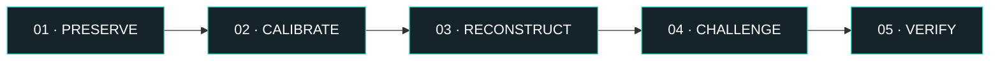
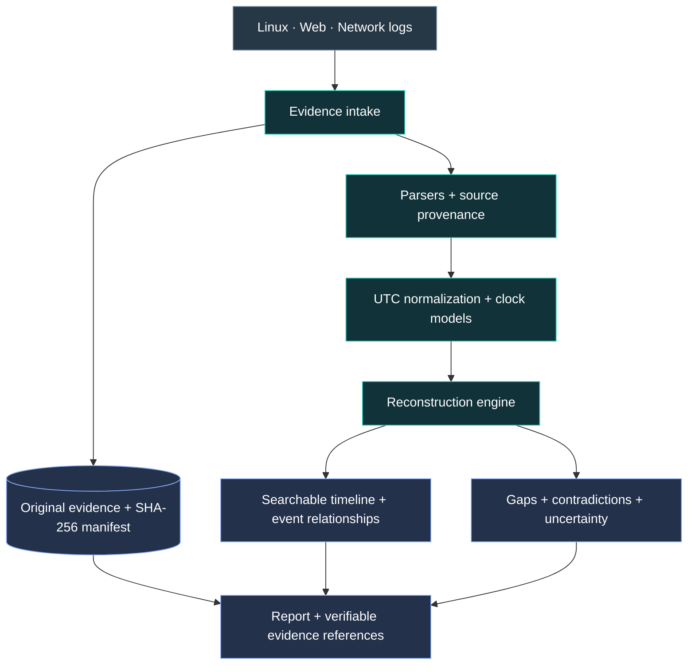

# ALIBI.

### Every incident has a story. Every story needs an ALIBI.

**An evidence-first cybersecurity incident reconstruction framework.**

AIORI Hackathon 3 &nbsp;·&nbsp; Cybersecurity &nbsp;·&nbsp; PS-013 &nbsp;·&nbsp; Team EXPOSE

<code>A3-PS013-TC452</code>

  

 

▶ Watch our orientation video: the problem, proposed approach, and team responsibilities.

---

### The problem isn't missing data. It's conflicting evidence.

During an incident, a Linux host, a web application, and a firewall may each record part of the same story. Their formats differ, their clocks may disagree, and some records may be missing. Sorting timestamps alone can make the sequence look certain when it isn't.

**ALIBI proposes a local, offline-first workbench to reconstruct the most defensible account of an incident — and show where the evidence runs out.**

### One incident. Two very different stories.

| Source | Raw timestamp (UTC) | Observed event |
|:--|:--|:--|
| Application | `04:42:54` | Authentication success, request `R7` |
| Web server | `04:44:07` | Login request, request `R7` |

A naïve sort places the success **before** its matching request. In our **synthetic** example, repeated matching request IDs support an estimated **+73-second application-clock correction**. ALIBI would retain both the original timestamp and a corrected *interval*, including uncertainty — not silently rewrite the record or claim that every ordering is proven.

> **Our principle:** Evidence first. Assumptions last.

---

## The proposed ALIBI framework

| Stage | What it means |
|:--|:--|
| **Preserve** | Keep original logs, their SHA-256 hashes, and source references. |
| **Calibrate** | Normalize to UTC; propose clock corrections only when supported by matching evidence. |
| **Reconstruct** | Build a searchable timeline and evidence-backed event relationships. |
| **Challenge** | Surface uncertain ordering, contradictory records, and parsing or coverage gaps. |
| **Verify** | Trace important findings back to the exact preserved evidence. |

### System at a glance

Proposed MVP: Python / FastAPI, SQLite, format-specific log parsers, UTC normalization, SHA-256 integrity checks, and rule-based reconstruction. Diagrams show intended architecture, not a completed deployment.

---

## Proposal & project status

**[Read the ALIBI project proposal →](./ALIBI_AIORI3_Proposal.pdf)**

The proposal contains the research context, relevant prior work, optimization rationale, architecture, data flow, and development milestones. The README is intentionally brief; the PDF is the technical reference.

**Current status:** Proposal / initial development. The three synthetic scenarios and manual-versus-assisted triage benchmark are planned validation activities. No unmeasured performance gains are claimed.

---

## Team EXPOSE

| Member | Project role | Profile |
|:--|:--|:--|
| **Anurag Deb** | Team Lead & Full-Stack Developer | [LinkedIn ↗](https://www.linkedin.com/in/debanurag) |
| **Sangram Keshari Patra** | Backend Developer | [LinkedIn ↗](https://www.linkedin.com/in/sangramkpatra/) |
| **Prof. Partha Chakraborty** | Faculty Mentor | [LinkedIn ↗](https://www.linkedin.com/in/partha-chakraborty-bb506638/) |

---

**ALIBI.** &nbsp;·&nbsp; **TEAM EXPOSE** &nbsp;·&nbsp; `A3-PS013-TC452`

AIORI Hackathon 3 · 2026

*Every incident has a story. Every story needs an ALIBI. What's yours?*

