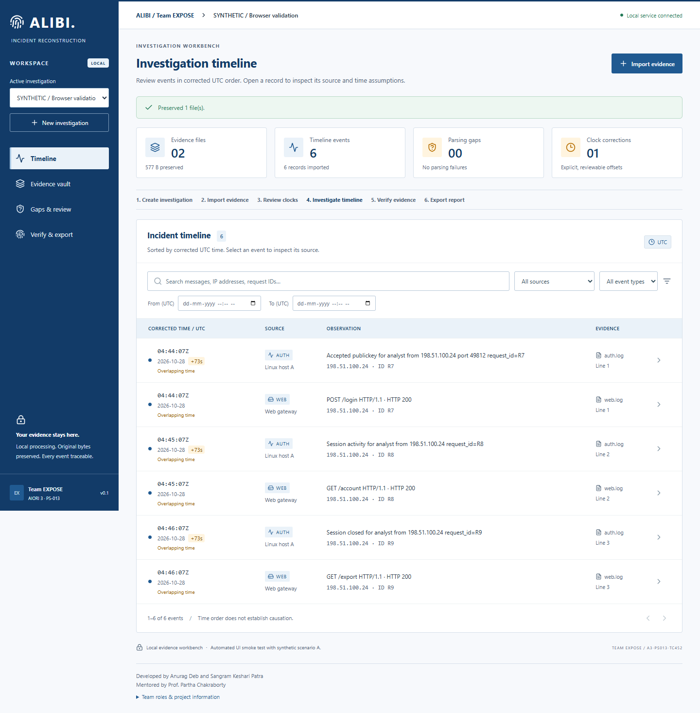
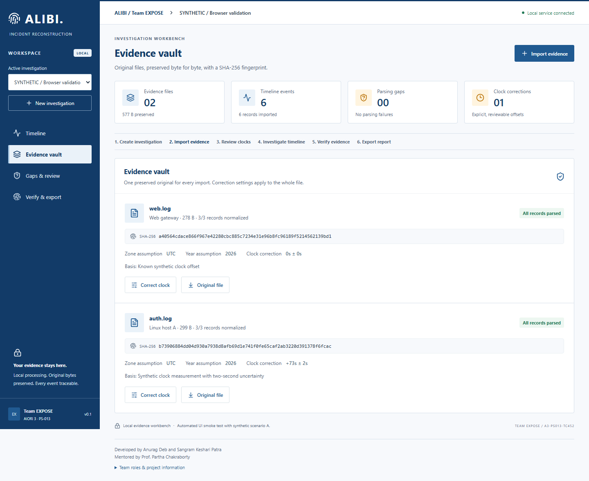
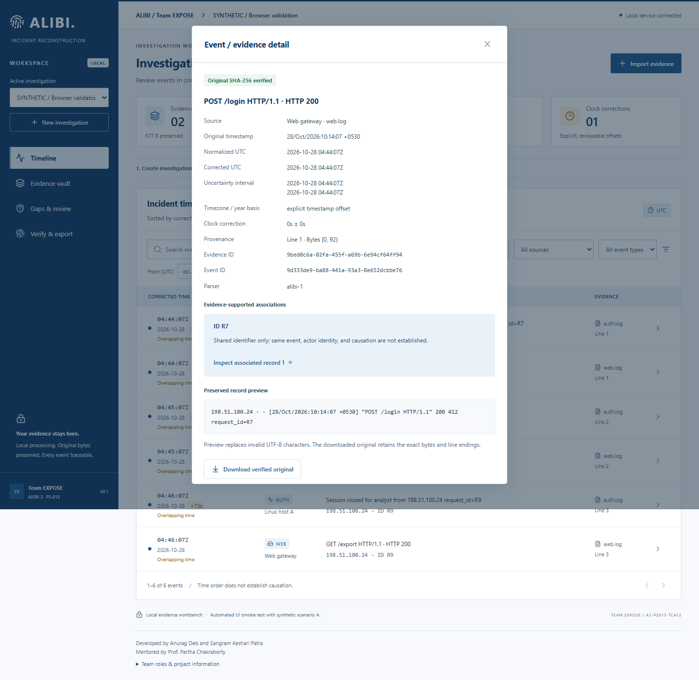
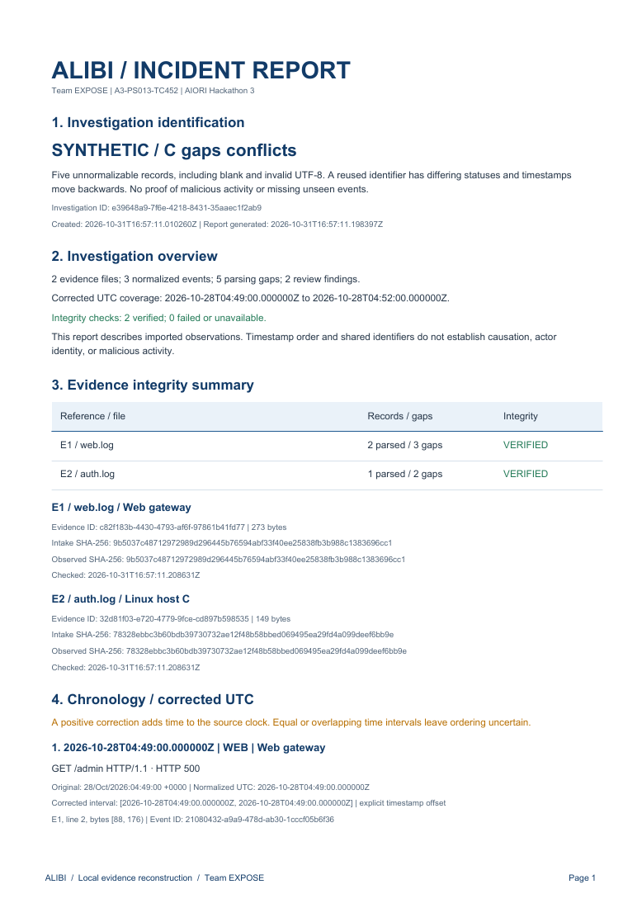

# ALIBI.

**Evidence-First Cybersecurity Incident Reconstruction**

Every incident has a story. 
Every story needs an ALIBI.

**Team EXPOSE · A3-PS013-TC452** 
AIORI Hackathon 3 | PS-013

**[Project introduction](https://youtu.be/RhR5dDCjA2M) · [Project proposal](ALIBI_AIORI3_Proposal.pdf) · [Live demo guide](DEMO_READY.md)**

Full demonstration: **`DEMO_VIDEO_URL_TO_BE_ADDED`**

<!-- FINAL DEMONSTRATION THUMBNAIL: insert the approved video thumbnail and URL here. -->

## The problem

A small IT team investigating an incident may find web requests on one server and authentication records on another. Their formats differ, one source uses local time, and another clock is slow. A login at 10:14 in one file can appear unrelated to an event at 04:42 elsewhere. Manually aligning these records takes time, invites arithmetic errors and can obscure gaps. Investigators also need unchanged originals and traceable references, often without specialist infrastructure or a dedicated forensic team.

## The ALIBI solution

ALIBI is an implemented local investigation workbench. A React interface connects to a Python/FastAPI backend and SQLite storage. It preserves imported files, records explicit time assumptions and builds a searchable chronology that investigators can inspect against original evidence. Processing requires no paid API, cloud database or external AI service.

The five-stage framework keeps each decision reviewable. **PRESERVE** retains original bytes and hashes. **CALIBRATE** normalizes UTC and records supported corrections. **RECONSTRUCT** orders observations. **CHALLENGE** exposes parsing failures and conflicting records. **VERIFY** checks integrity and exports findings with their limitations.

~~~mermaid
flowchart LR
    A[Import] --> B[Preserve]
    B --> C[Normalize]
    C --> D[Correct clocks]
    D --> E[Reconstruct]
    E --> F[Review gaps]
    F --> G[Verify]
    G --> H[Export]
~~~

Create an investigation, import each source separately and review its timezone and year assumptions. A positive correction adds time to a slow clock. Original timestamps, normalized UTC and corrected timestamps remain distinct. Shared identifiers and nearby times support inspection; they do not establish actor identity or causation.

## Product preview

These are real captures of ALIBI using the included synthetic scenarios, not mockups. The timeline keeps chronology central; source inspection exposes the evidence behind a row. Reports summarize findings while the JSON export retains complete audit details.

<table>
<tr><th>Investigation timeline</th><th>Evidence vault</th></tr>
<tr><td></td><td></td></tr>
<tr><th>Original record inspection</th><th>Incident report</th></tr>
<tr><td></td><td align="center"></td></tr>
</table>

## Verified capabilities

| Capability | Implemented behavior |
| --- | --- |
| Linux auth/syslog | Traditional yearless and supported ISO-timestamp records |
| Apache/Nginx access | Common/combined access logs |
| Original evidence | Byte-preserving storage, raw lines and line/byte provenance |
| SHA-256 | Intake hashes, fresh verification and independent manifests |
| Time processing | Explicit timezone/year assumptions and UTC normalization |
| Manual correction | Absolute offsets, reasons and supplied uncertainty bounds |
| Reviewed anchors | Constant-offset proposals with sufficient same-event anchors and explicit approval |
| Searchable chronology | Text, source, type and date filters with pagination |
| Parsing-gap ledger | Failed records retained; deterministic conflicts flagged for review |
| Synthetic validation | Three scenarios with separate ground-truth fixtures |
| Reports | Readable PDF, lossless JSON and SHA-256 manifest |
| Local operation | SQLite and loopback services; offline processing after dependency installation |

Unsupported records become visible gaps instead of disappearing. Imports are limited to 10 MiB and 50,000 records per file. Yearless records require a supplied year; ambiguous daylight-saving timestamps are rejected rather than guessed. Reviewed anchor calibration requires justified same-event correspondence, not merely matching strings.

## Validation and benchmarks

The latest release validation on **31 October 2026** passed **30 backend tests**, TypeScript validation, the Vite production build and browser smoke. Browser checks covered 1440px, 768px and 390px layouts without console errors. All six synthetic originals passed independent manifest verification, and isolated tests detected tampering. These checks verify the documented workflow; they are not production-security certification.

| Synthetic scenario | Normalized events | Retained gaps | Focus |
| --- | ---: | ---: | --- |
| A — conflicting clocks | 6 | 0 | +05:30 timezone and +73-second correction |
| B — cross-source reconstruction | 6 | 0 | Alternating web/auth observations, explicit -04:00 |
| C — gaps and conflicts | 3 | 5 | Invalid date, unsupported records, blank line and bad encoding |
| Total | **15** | **5** | Independent ground truth and reproducible fixtures |

### Independently published data

An unchanged 1,000-record prefix of Elastic's published NGINX sample passed through the existing pipeline. Three fresh-investigation imports used the same running backend; warm caches may influence timings. The original download, selected prefix and exported originals were hashed and checked. No parser changes were made for this benchmark.

| External benchmark | Measured result |
| --- | ---: |
| Input / normalized / gaps | **1,000 / 1,000 / 0** per run |
| Parsing coverage | **100% of the selected prefix** |
| Median import and processing | **0.169648 seconds** |
| Median throughput | **5,894.55 records/second** |
| Median timeline search latency | **24.171 ms** |
| SHA-256 verification | **Passed in all three runs** |
| PDF generation | **5.598301 seconds**, one measurement |

Parsing coverage measures accepted records, not incident-detection accuracy. The prefix is reproducible but not representative of every log source. Processing time is not human investigation time. [Dataset attribution, exact selection, commands and full results →](docs/EXTERNAL_VALIDATION.md)

### Exploratory human pilot

Anurag Deb completed a narrow three-auth-event timestamp task manually, then with ALIBI. Both methods identified all three events. The manual calculation mistakenly added 77 rather than the supplied 73 seconds, making each answer four seconds late.

| Measure | Manual | ALIBI-assisted |
| --- | ---: | ---: |
| Recorded elapsed time | **62.000 s** | **26.029 s** |
| Events identified | **3/3** | **3/3** |
| Exact timed timestamp accuracy | **0/3** | **3/3** |

The observed ratio was **2.38x**, with **35.971 seconds** saved and approximately **58.0%** less time in this task. This is not a general speedup claim: one developer performed sequential trials, and correct answers were known before assisted timing. Learning and familiarity bias are substantial. Final reviewed timestamps are correct for all three events; the original manual errors remain recorded. [Method, observations and limitations →](docs/EVALUATION.md)

## Quick start

Use **Python 3.12**, **Node.js 22** and Windows PowerShell **5.1 or later**. From the repository root, install dependencies once; internet is needed for installation. The application itself processes evidence locally. Start the services in two terminals so stopping them is straightforward.

~~~powershell
# One-time setup, repository root
powershell.exe -NoProfile -File scripts/setup.ps1

# Terminal 1: backend
.\.venv\Scripts\python.exe -m uvicorn alibi.main:app --app-dir src/backend --host 127.0.0.1 --port 8000
~~~

~~~powershell
# Terminal 2: frontend, starting from repository root
Set-Location src/frontend
node node_modules/vite/bin/vite.js --host 127.0.0.1 --port 5173
~~~

Open **http://127.0.0.1:5173**. Health: http://127.0.0.1:8000/api/health. **Stop:** press `Ctrl+C` in each service terminal. For background startup and presentation fallbacks, see the demo guide.

~~~powershell
# Tests, repository root
$testDirectory = ".alibi/tests-$([guid]::NewGuid().ToString('N'))"
.\.venv\Scripts\python.exe -m pytest -q -p no:cacheprovider --basetemp $testDirectory
.\.venv\Scripts\python.exe scripts/smoke.py
~~~

The smoke command needs both services and creates labeled synthetic investigations. Keep services on loopback: this prototype has no authentication or production hardening. PDF uses a Latin-1 font; JSON and original downloads preserve full content. No complete causal graph, clock-drift estimation or statistical uncertainty model is claimed.

## Project structure

~~~text
src/backend/    FastAPI, SQLite, parsers, calibration, reports and tests
src/frontend/   React workbench, Vite build and browser smoke
datasets/       Three synthetic scenarios and independent ground truth
scripts/        Setup, startup, verification and benchmark tools
docs/           Architecture, validation, evaluation and product captures
~~~

Generated `output/`, the local evidence/database directory `.alibi/`, virtual environments and caches are ignored by Git. External raw logs remain local; only measurement metadata and reproducible tooling are included. Keep the database and evidence vault together when backing up a stopped application.

## Documentation

| Resource | Link |
| --- | --- |
| Original proposal | [ALIBI proposal](ALIBI_AIORI3_Proposal.pdf) |
| Original PS-013 statement | [Problem statement](docs/PS-013.pdf) |
| Architecture and boundaries | [Architecture](docs/ARCHITECTURE.md) |
| Automated release checks | [Validation](docs/VALIDATION.md) |
| External dataset benchmark | [External validation](docs/EXTERNAL_VALIDATION.md) |
| Human observations and methodology | [Evaluation](docs/EVALUATION.md) |
| Five-minute presentation | [Demonstration guide](DEMO_READY.md) |

## Team and credits

Developed by Anurag Deb and Sangram Keshari Patra 
Mentored by Prof. Partha Chakraborty

**TEAM EXPOSE · A3-PS013-TC452**

| Contributor | Role | Profile |
| --- | --- | --- |
| Anurag Deb | Team Lead & Full-Stack Developer | [LinkedIn](https://www.linkedin.com/in/debanurag) |
| Sangram Keshari Patra | Backend Developer | [LinkedIn](https://www.linkedin.com/in/sangramkpatra/) |
| Prof. Partha Chakraborty | Faculty Mentor | [LinkedIn](https://www.linkedin.com/in/partha-chakraborty-bb506638/) |

ALIBI is an independent Team EXPOSE project; it does not imply government affiliation.

**ALIBI · Team EXPOSE · AIORI Hackathon 3**

*Evidence first. Assumptions last.*

ALIBI is a local, offline-first incident investigation aid and does not claim forensic certification.
